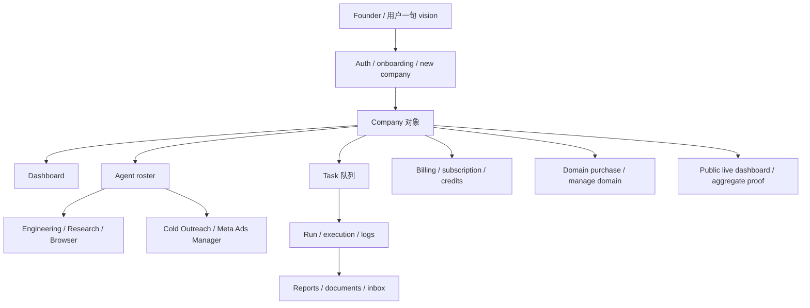

# CASE-008 Polsia / POSA 零员工 AI 公司模式

检查日期：2026-05-28 Asia/Shanghai

## 结论

这条资料应进入资料库。截图里的 `POSA` 更像是中文二次传播或 OCR/转述误写，公开证据对应的项目是 `Polsia`。官网结构化数据写明创始人为 `Ben Cera`，并关联 `benbroca` 社交账号；截图中的 `Ben Broca/Brocka` 与公开账号 handle 有重合，但姓名写法存在转述差异。

Polsia 不是可安装的开源项目，而是闭源产品化案例。它适合作为“一人 AI 公司 / 零员工公司操作系统”的产品路线样本：吸收其控制台、公司对象、agent 分工、运行日志、公开指标面板、支付/订阅/任务额度、域名购买流和广告/外联自动化的机制；不吸收其真实账号接管、真实邮件/广告发送、收入分成、股权授权、投资人外联自动化等高风险动作。

推荐动作：`REPLAY`。用 mock 原型复现机制，不登录真实账号，不连接真实发送渠道，不导入密钥。

## 证据

| 证据 | 路径或 URL | 说明 |
|---|---|---|
| 用户截图 1 | `H:\AI\_explore\one-person-ai-company-success-routes-20260528\screenshots\polsia-posa-20260528\source-screenshot-1.jpg` | 中文二手资料，声称三分钟建站、支付、广告、融资等 |
| 用户截图 2 | `H:\AI\_explore\one-person-ai-company-success-routes-20260528\screenshots\polsia-posa-20260528\source-screenshot-2.jpg` | 二手资料，提出 80/20、每月约 50 美元、真人品味不可替代 |
| 用户截图 3 | `H:\AI\_explore\one-person-ai-company-success-routes-20260528\screenshots\polsia-posa-20260528\source-screenshot-3.jpg` | 二手资料，强调 AI 局限、信任、隐私、合规风险 |
| 官网 HTML | `H:\AI\_explore\one-person-ai-company-success-routes-20260528\sources\web\polsia-posa-20260528\polsia_com.html` | 标题、SEO、JSON-LD、价格区间、创始人信息 |
| 前端 JS | `H:\AI\_explore\one-person-ai-company-success-routes-20260528\sources\web\polsia-posa-20260528\assets_index_DGRm7ehX_js` | 可见 dashboard、agents、tasks、reports、billing、domain、ads/outreach 等前端功能痕迹 |
| API 端点清单 | `H:\AI\_explore\one-person-ai-company-success-routes-20260528\sources\web\polsia-posa-20260528\extracted-api-endpoints-interesting.txt` | 从前端包提取的关键 API 路由 |
| 公开 live dashboard | `H:\AI\_explore\one-person-ai-company-success-routes-20260528\sources\web\polsia-posa-20260528\public-live-dashboard-summary.json` | 公开指标、日志、活动样本 |
| 登录边界探测 | `H:\AI\_explore\one-person-ai-company-success-routes-20260528\sources\web\polsia-posa-20260528\read-only-api-probe-results.json` | 未登录状态、受保护 API 401 |

公开 URL：

- `https://polsia.com/`
- `https://polsia.com/live`
- `https://polsia.com/new`
- `https://polsia.com/login`

## 已核实内容

| 项目 | 公开证据结论 | 可信度 |
|---|---|---|
| Polsia 定位 | 官网描述为运行公司的自治 AI 系统，做规划、代码、营销、运营 | 高 |
| 创始人 | JSON-LD 写 `Ben Cera`，社交链接含 `benbroca` | 中高 |
| 技术叙事 | 官网结构化数据称使用 `Claude Agent SDK` | 中高 |
| 公司创建方式 | FAQ/前端显示用户用 vision 创建公司，AI agent 执行日循环 | 中高 |
| Agent 角色 | 公开 live 日志和前端显示 Engineering、Research、Browser、Cold Outreach、Meta Ads Manager 等 | 高 |
| 核心对象 | 前端包出现 companies、agents、tasks、reports、documents、dashboard、inbox/chat、activities、billing、domain 等 | 高 |
| 收费 | JSON-LD 标价区间 29-59 美元，前端出现 `49/mo`、3 天 trial、run-now credit、extra company price | 中高 |
| 公开指标 | `/api/public/live/dashboard` 返回 ARR、MRR、公司数、任务数、邮件数、广告数、活动日志 | 中高，属于平台自报 |
| 登录 | `/api/auth/session` 返回 authenticated false；companies/tasks/reports/subscription 等 API 无登录返回 401 | 高 |

## 未核实或只能作为二手资料的内容

| 截图声称 | 当前判断 |
|---|---|
| 两周内年化收入增长 10 倍 | 未找到独立公开证据，只能列为二手资料 |
| 最新数据 150 万美元收入 | 与 2026-05-28 公开 live dashboard 的 ARR 数字不一致，需标注日期差异和来源差异 |
| AI 自动联系 77 家投资机构、吸引 18 位投资人 | 未验证，不吸收真实融资外联动作 |
| 给 AI 公司 10% 真实股权 | 未验证，且属于高风险治理/法律边界，不吸收 |
| 1000+ AI 代理运营 1000+ 公司 | live dashboard 显示多公司与多 agent 活动，但具体 1000+ 运营叙事仍按平台自报处理 |

## 功能实现推断

这是基于公开前端和 API 路由的推断，不等于源码级确认。

公开前端显示的关键实现线索：

- 公司是核心容器：`/api/companies`、`/api/company`、`/api/company/settings`、`/api/company/dashboard-inbox`。
- 任务是执行单元：`/api/tasks`、`/api/tasks/{id}/run-now`、recurrence、assign。
- Agent 是执行角色：`/api/agents`、`/api/agents/{id}/run`。
- 报告和文档沉淀运行结果：`/api/reports`、`/api/company-documents`。
- 订阅和额度控制执行强度：`/api/subscription`、`/api/checkout/billing-portal`、run-now credit、task credits。
- 域名购买通过 chat 驱动，先 quote 后 confirm：`/api/company-domain/purchase-sessions`、`quote`、`confirm`、`/api/chat/domain-purchase-kickoff`。
- 增长动作包含外联、Twitter、广告：`outreach/start`、`twitter/start`、`ads/start-campaign`、`ads/pause`、`ads/resume`。
- 公开 live dashboard 用聚合指标证明系统运行，但受保护 dashboard 需要账号。

## 对“一人公司/零人公司”的判断

这更准确地说是“一人公司操作系统”，不是完全零人公司。

原因：

- 官网和前端都以用户创建 company/vision 为入口，需要人类提供方向。
- 订阅、付款、域名、广告、外联、合规仍需要人类承担责任。
- 截图自己也提到 80/20：AI 做标准化执行，人类保留审美、价值观、定位、信任与关键决策。
- 公开 API 显示登录、订阅、额度和受保护 dashboard 边界，说明并非无主自治企业。

## 可吸收机制

| 机制 | 吸收方式 | 映射到本地体系 |
|---|---|---|
| 一句话 vision -> company object | 新建 `Company Brief` 模板，生成目标、禁区、任务池、角色池 | ECC / 技能包 / Codex task report |
| AI employee / agent roster | 把角色固定为 Research、Engineering、Growth、Ops、Reviewer、Finance Mock | Codex / OpenClaw / Hermes |
| Task + Run + Report | 每个 agent 输出任务、执行状态、证据、失败原因和复盘 | 运行报告 / 任务复盘 |
| Public live dashboard | 本地控制台只展示 mock 指标、运行证据、任务状态，不接真实外部服务 | AICompany Dashboard |
| Domain/payment/ad as capability nodes | 只做 read-only 或 mock 节点，真实动作必须审批 | 审批门 / GOVERNANCE |
| Subscription/credits gate | 变成本地“预算/算力/时间额度”门，不接真实付款 | New API 3011 / Hermes 预算 |
| Company paused/unpause | 任何公司运行可暂停、恢复、冻结外部动作 | OpenClaw/Hermes safety |
| 80/20 taste boundary | AI 执行 80% 标准化，人类审批 20% 品味与战略 | ECC 12 层流程 |
| Public proof log | 每次运行输出 evidence bundle，而不是只输出摘要 | SOURCE-OF-TRUTH-MAP |

## 不吸收内容

| 不吸收项 | 原因 |
|---|---|
| 自动真实发邮件给投资人/客户 | 真实发送渠道和声誉风险 |
| 自动开广告账户或真实投放 | 花钱、账号风控、合规风险 |
| AI 持有股权或自动融资 | 法律、财务、治理边界过高 |
| 直接托管用户敏感权限 | 密钥、隐私、支付和账号安全风险 |
| 复制 Polsia 品牌或 UI | 不复制品牌和私有产品表达 |
| 盲目安装或接入闭源服务 | 不符合本技能包“昨日重现”规则 |

## 建议进入 Polsia / AICompany Dashboard 的 MVP

只做控制台原型，不做真实接入。

1. `Company`：公司名称、愿景、目标、禁区、当前状态、预算。
2. `Agent Roster`：Research、Engineering、Growth、Ops、Reviewer、Finance Mock。
3. `Task Queue`：待办、运行中、完成、阻塞、需要审批。
4. `Run History`：每次运行的输入、输出、证据、成本、风险、复盘。
5. `Proof Dashboard`：本地 mock ARR、任务数、内容产出、失败率、审批次数。
6. `Approval Gate`：域名、广告、邮件、付款、投资人外联一律只显示“需要人工批准”，不执行。
7. `Replay Mode`：把外部案例转成 mock 任务包，验证机制是否适合本地体系。

## 下一步

- 追加为 route matrix 的 `REPLAY` 项，不覆盖原 Polsia 候选。
- 2 天轻量更新时复查官网、live dashboard、公开报道和开源替代项目。
- 如果用户以后提供可安全使用的测试账号，也只做 read-only 观察；涉及付款、发送、广告、域名购买、真实企业授权时仍需停在审批门。
