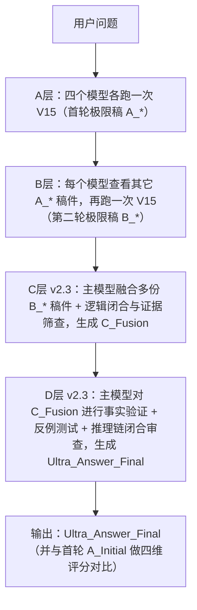

````markdown
# UltraFusion Phase 0 — 手工运行 RUNBOOK v1.1  
（多模型 + V15 · 手工版 · A/B/C/D 全套模板整合）

> 本文件定位：**UltraFusion_Phase0_RUNBOOK_v1.1.md**  
> 你可以直接放进 GitHub 仓库 `UltraFusion-SpecKit/RUNBOOK/` 下使用。  
> 特点：
> - 不写代码，只用浏览器 + 多个 AI 官网  
> - 提供 A / B / C v2.3 / D v2.3 全套通用模板  
> - 每一段都完整，无省略号，可整块复制  
> - 适用于任意领域问题（医学 / 金融 / 教育 / 编程 / 工程 / 法律 / 日常咨询等）

---

## 0. 文档目的（Purpose）

本 RUNBOOK 的目标：

在完全不写代码的前提下，只用「浏览器 + 多个 AI 官网网页」，  
跑出一套 **多模型 + 多次 V15 迭代 + 融合 + 事实验证** 的 UltraFusion 流程，  
验证它是否能稳定得到明显优于单模型的答案，目标准确率进入 **95–99% 区间（可验证 + 有证据）**。

- **Phase 0**：纯人工 + 纯浏览器（本文件只覆盖这一阶段）  
- **Phase 1**：浏览器机器人自动化（例如 Playwright 等）  
- **Phase 2**：多模型融合服务化（给普通用户直接用的 Web 服务）

本文件 v1.1 相比 v1.0 的主要升级：

1. 引入 **C 层 v2.3（逻辑闭合增强版）**  
2. 引入 **D 层 v2.3（事实验证终审 · 全新候选答案模式）**  
3. 明确：**不再强制要求 E 层长篇报告**，但在 D 层中必须对「首轮 vs 最终」做量化对比。  
4. 全文模板 **完全领域通用**，不带任何特定病种/任务的残留例子。

---

## 1. 仓库结构与文件布局（人看的，不是给 AI 的）

推荐仓库结构如下：

```text
UltraFusion-SpecKit/
│
├── SPEC_KIT/                      ← 所有“规范类文件（SPEC）”放这里
│   ├── SPEC_v1.1.md               ← UltraFusion 系统规范（你的主规范）
│   └── V15_FULL.md                ← 完整的 V15 规范原文（你手工粘贴给 AI 用）
│
├── RUNBOOK/                       ← 所有“运行手册（执行步骤）”放这里
│   ├── UltraFusion_Phase0_RUNBOOK_v1.0.md   ← 旧版（可保留做历史记录）
│   └── UltraFusion_Phase0_RUNBOOK_v1.1.md   ← 本文件（最新版）
│
├── NOTES/                         ← 可选：你记录模型表现 & Bug 用
│   └── model_behavior_notes.md
│
└── README.md                      ← 仓库总说明（建议放简介 + 目录）
````

⚠ **重要说明**：

* `V15_FULL.md` 只是你自己存放完整 V15 的地方，方便复制。
* 在和各个 AI 对话时，它们完全不知道这个文件存在。
* 所以 **每一次用到 V15，都必须在提示词里重新粘贴完整 V15**。
* 不能写「参考之前的 V15」，模型不会自动记住。

---

## 2. 使用的模型与登录方式（Phase 0）

Phase 0 使用 4 个「官网网页」模型（可按实际增减）：

| 模型            | 登录方式  | 备注              |
| ------------- | ----- | --------------- |
| OpenAI GPT    | 官网网页版 | 账号登录后可长期保持登录    |
| Google Gemini | 官网网页版 | 用 Google 账号登录   |
| xAI Grok      | 官网网页版 | 用 X 账号登录        |
| DeepSeek      | 官网网页版 | 用手机号/账号登录，可保持登录 |

✅ 这 4 个都在浏览器里打开并保持登录即可。

后续 Phase 1 自动化可以用浏览器机器人（如 Playwright）复用这些已登录状态。

---

## 3. Phase 0 总体流程概览

**目标结构：**

* **A 层**：4 个模型各自用 V15 生成「首轮极限稿」
* **B 层**：每个模型看其它模型的稿子，再用 V15 生成「第二轮极限稿」
* **C 层 v2.3**：由 GPT（或你指定的主模型）做「多稿融合 + 逻辑闭合增强」
* **D 层 v2.3**：同一主模型对 C_Fusion 做最终「事实与逻辑终审」，产出 Ultra_Answer_Final，并对「首轮 vs 最终」做量化对比

---

### 3.1 流程图（Mermaid，GitHub 可直接渲染）



> 说明：
>
> * **E 层长篇报告（8–12 页）在 Phase 0 不再强制**，只在你特别需要做“金标库 + 专题报告”时单独调用。
> * 本 RUNBOOK v1.1 把重点放在 A/B/C/D 四层流程闭环 + 评分对比上。

---

## 4. 准备工作（Step 0：操作环境）

在开始前，建议你完成：

1. 打开 4 个浏览器标签页：

   * GPT 官网
   * Gemini 官网
   * Grok 官网
   * DeepSeek 官网

2. 确认：

   * 都已登录，可以直接提问；
   * 页面不会很快自动登出（必要时先做一次正常对话刷新登录态）。

3. 在本地或 GitHub 中准备好一份完整的 V15 文本：

   * 推荐放在 `SPEC_KIT/V15_FULL.md`；
   * 每次需要时，从这里复制完整 V15 到提示词中。

4. 准备好要测试的用户问题（可以先从 1 题开始）：

   * 比如：Q1、Q2…，后续可以配合“专家测试题清单（Q1–Q12）”一起用。

---

## 5. A 层：四个模型生成「首轮极限稿」（第一次使用 V15 × N）

### 5.1 A 层目标

对每个模型（GPT / Gemini / Grok / DeepSeek）：

1. 提供完整 V15 文本 + 当前用户问题；
2. 要求它严格按 V15 执行完整迭代流程；
3. 输出它这一次的「最高分版本答案」 = **首轮极限稿 A_*。**

最终得到 3–4 份首轮极限稿：

* A_GPT
* A_Gemini
* A_Grok
* A_DeepSeek

---

### 5.2 A 层通用提示模板（每个模型都用这一份）

> 💬 你在每个模型网页里这样发（只改 V15 和用户问题那两块）：

```text
你将严格执行我下面提供的完整《智能问答迭代优化系统 V15（终极完美·最简执行版）》，
不得增删改任何条款。

【V15 规范原文（每次都要完整粘贴）】
------------------------------------------------
（请在这里粘贴完整 V15 文本）
------------------------------------------------


【任务说明】
请你对下面这个问题，严格按 V15 规范执行完整迭代流程，
一直到触发终止条件（例如：达到硬闸门或资源上限），
并输出你得到的“最高分版本答案”。

【用户问题】
------------------------------------------------
（在这里粘贴本次要回答的问题全文）
------------------------------------------------

【输出要求】
1. 请在回答结尾，清晰标明这是你本轮在 V15 流程下得到的“最高分版本答案”。
2. 若你在中途进行了多轮迭代，请只输出最终版本的完整内容；中间过程不必全部展开。
3. 不要省略关键步骤的结论，不要只给框架，必须给出完整可读、可执行的答案文本。
```

⚠ 使用说明：

* **必须**包含完整 V15 文本（每个模型、每次调用都要重新粘粘）。
* 你只需改两处：

  1. 把 V15 文本粘进【V15 规范原文】；
  2. 把当前问题粘进【用户问题】。
* 一般来说，同一问题在 4 个模型上各跑一次，就得到 4 份 A_* 稿件。

---

## 6. B 层：每个模型根据其它稿件，再跑一次 V15（第二轮极限稿）

### 6.1 B 层目标

对每个模型（例如 GPT）：

1. 给它看：

   * 自己的首轮稿（如 A_GPT）
   * 其它模型的首轮稿（A_Gemini / A_Grok / A_DeepSeek）

2. 让它先对这些稿件进行 V15 式的对比评审；

3. 再在此基础上，重新跑一次完整 V15，生成一个「更强的新版本」：

   * B_GPT
   * B_Gemini
   * B_Grok
   * B_DeepSeek

这一步相当于：

> **让每个模型站在“多份答案堆”的肩膀上，再冲一次 V15 极限。**

---

### 6.2 B 层通用模板（每个模型各用一次）

> 📌 例如，你在 GPT 网页里这样发（以 GPT 通道为例）：

```text
你将严格执行我下面提供的完整《智能问答迭代优化系统 V15（终极完美·最简执行版）》，
不得增删改任何条款。

【V15 规范原文（每次都要完整粘贴）】
------------------------------------------------
（请在这里粘贴完整 V15 文本）
------------------------------------------------


【同一问题的多份“首轮极限稿”（A 层输出）】
下面是多个模型在同一个问题上的首轮极限稿（包括你自己的和其他模型的）：

# 模型稿件列表

- 稿件 1（例如 GPT 首轮稿 A_GPT）：
------------------------------------------------
（在这里粘贴 A_GPT 的首轮极限稿）
------------------------------------------------

- 稿件 2（例如 Gemini 首轮稿 A_Gemini）：
------------------------------------------------
（在这里粘贴 A_Gemini 的首轮极限稿）
------------------------------------------------

- 稿件 3（例如 Grok 首轮稿 A_Grok）：
------------------------------------------------
（在这里粘贴 A_Grok 的首轮极限稿）
------------------------------------------------

- 稿件 4（例如 DeepSeek 首轮稿 A_DeepSeek）：
------------------------------------------------
（在这里粘贴 A_DeepSeek 的首轮极限稿）
------------------------------------------------


【任务要求】

1. 请你先根据 V15，对上述 A 层稿件进行对比评审：
   - 标出各自的主要优点和主要缺点；
   - 标出关键事实错误或可疑之处（如有）；
   - 初步判断目前哪一份稿件在“准确性/完备性/结构/深度”综合表现上最优，并说明理由（不必给精确数字，但要给出排序逻辑）。

2. 然后，请你再运行一次完整 V15 流程：
   - 以“综合所有稿件优点、修复其缺点”为目标；
   - 在考虑其他稿件信息的前提下，重新回答该问题；
   - 生成一个新的、更高质量的“第二轮极限稿”；
   - 按 V15 规范输出你在本轮得到的“最高分版本答案”。

3. 输出要求：
   - 请在回答中清晰标记本轮输出为“第二轮极限稿 B_*（以你自己为通道标签，例如 B_GPT）”；
   - 若你发现原 A 层稿件中有严重错误或不适用结论，请在本轮中修正并简要说明。
```

* 对 Gemini / Grok / DeepSeek 也一样，只是通道标签变为 `B_Gemini / B_Grok / B_DeepSeek`。
* 完成后你会得到：B_GPT, B_Gemini, B_Grok, B_DeepSeek。

---

## 7. C 层：融合多份 B 稿，生成 C_Fusion（v2.3 · 逻辑闭合增强）

这一节直接使用你刚刚确认的 **C 层通用模板 v2.3（完整版）**。

> ✅ 你一般在 GPT 网页中执行 C 层，把它作为“主融合器”。

---

### 7.1 C 层模板 v2.3（完整可复制）

> 📌 在 GPT 中发下面这整段（只改 V15 + 各 B_* 文本）：

```text
【C 层通用融合模板 v2.3（完全领域通用 · 逻辑闭合增强版）】

你将严格执行我下面提供的完整《智能问答迭代优化系统 V15（终极完美·最简执行版）》，
不得增删改任何条款。

------------------------------------------------
【V15 规范原文（必须完整粘贴）】
------------------------------------------------
（在这里粘贴完整 V15 文本，必须为当前版本的完整正文）
------------------------------------------------


【同一问题的多份“第二轮极限稿”（B 层输出）】
下面是多个模型在同一问题上的第二轮极限稿（数量可以为 3–4 份，不足时按实际填写）：

- B_GPT：
------------------------------------------------
（粘贴 B_GPT 第二轮极限稿全文）
------------------------------------------------

- B_Gemini：
------------------------------------------------
（粘贴 B_Gemini 第二轮极限稿全文，如该通道缺失，请写明“本轮缺失及原因（例如：模型不可用）”）
------------------------------------------------

- B_Grok：
------------------------------------------------
（粘贴 B_Grok 第二轮极限稿全文）
------------------------------------------------

- B_DeepSeek：
------------------------------------------------
（粘贴 B_DeepSeek 第二轮极限稿全文，如该通道缺失，请写明“本轮缺失及原因”）
------------------------------------------------


================================================
【全局硬约束：证据与数据要求（领域通用）】
================================================

在下面执行所有步骤时，你必须同时遵守以下“证据与数据”硬规则（适用于任何领域）：

1. 所有关键结论必须“有理有据”
   - 可以接受的证据/依据类型包括但不限于：
     • 本领域的权威指南、共识、标准、协议
     • 系统综述、多篇文献交叉信息、技术报告
     • 官方机构、政府部门、国际组织发布的信息或统计
     • 主流教材、教科书、权威技术文档
     • 官方统计数据、年报、白皮书、大型数据集
     • 知名开源项目或产品的官方文档
     • 在业界/学界被普遍采用的方法（需说明其普遍性与局限）

2. 禁止捏造“看起来很专业”的具体数据
   - 禁止无来源地编造：
     • 精确百分比（例如：47.3%）
     • 精确样本量（例如：n=1234）
     • 具体期刊名 + 年份 + 卷期号组合
     • 并不存在的标准号、法规号、文献编号等
   - 如无法确认具体数值，只能使用：
     “有资料提示”“部分文献/报告认为”“目前尚无一致定量结论”
     并在合适处标注“需人工复核”。

3. 关键事实必须尽量注明“证据来源类型”
   - 对每条关键事实，尽量说明：
     “依据本领域权威指南”“可在主流教科书中查证”“来源于官方统计数据”
     等来源类型，而不是空口无依据。

4. 不可验证内容必须降级处理
   - 若某个信息目前不能通过公开权威资料或可靠来源验证：
     必须标记为“不可验证/需人工复核”，不得当作确定事实强行使用。
   - 对此类内容，只能作为假设或经验性建议呈现，并明确提醒存在不确定性。

5. 一句话原则（务必遵守）
   - **没有证据或来源类型说明，就没有充分说服力。**
   - 在后续 D 层中，凡是缺乏证据类型说明的关键句，都会显著拉低“准确性”评分。


================================================
【C 层任务总览（v2.3 版）】
================================================

你在本 C 层需要完成三块工作：

1. 对所有 B 层稿件进行“多通道对比评审 + 逻辑闭合性筛查”
2. 在此基础上，重新运行一次完整 V15，生成融合极限稿 C_Fusion
3. 输出：
   - 【最终答案：C_Fusion】
   - 【评审报告】（含证据与逻辑筛查结果）
   - 【版本说明】（说明融合来源与删改原则）


------------------------------------------------
一、B 层多通道综合评审 + 逻辑闭合性筛查
------------------------------------------------

请你先对上述 3–4 份 B 层稿件进行系统评审，包含：

【1.1 内容维度评审】

对每份稿件分别评估：

- 准确性（是否存在明显事实错误或严重“要证不证”的说法）
- 完备性（是否覆盖本问题的关键方面，有无明显重要遗漏）
- 结构与清晰度（是否条理清楚、层次合理、方便读者理解）
- 深度与洞察力（是否给出了合理的机制分析、因果链、策略或启发）

【1.2 逻辑闭合性筛查（C 层 v2.3 新增硬要求）】

对每份 B 稿，你必须检查并指出是否存在：

- 逻辑跳步：
  直接从某个描述跳到结论，中间缺乏必要的推理步骤或桥接论据。
- 逻辑断点：
  推理链 A → B → C 中，某些中间环节在正文中未被说明或支撑。
- 循环论证：
  结论 A 依赖于命题 B，而命题 B 又是通过命题 A 得出的。
- 前提不一致：
  不同 B 稿对于前提/假设的描述互相冲突，但各自却给出相同结论，且未解释差异。
- 结论冲突但无解释：
  不同 B 稿对同一问题给出明显相反或不兼容结论，却未说明适用条件或背景差异。
- 证据等级混乱：
  将弱证据（例如零散经验或小样本报告）写成强结论，或反之。

请你在评审报告中，用简明的形式列出上面这些问题在各稿件中的存在情况。

【1.3 反向一致性检查（Reverse Consistency Check）】

对于每份 B 稿中的关键结论，你需要回答两个问题：

1. 若结论为真，哪些前提必须成立？
2. 这些前提是否已经在稿件中被明确提出或有事实支撑？

若发现存在“隐含但未说明”的关键前提，你必须在评审报告中指出，并在后续 C_Fusion 中通过：
- 显式补写前提；
- 或者下调该结论的确定性/适用范围；
来修复这一问题。

【1.4 证据等级与结论强度匹配（Evidence Alignment Rule）】

你需要检查每份 B 稿中“证据类型”与“结论强度”是否匹配。参考规则：

- 权威指南 / 标准 / 共识 → 可支持强结论
- 系统综述 / 多篇可靠文献 → 可支持强或中等偏强结论
- 单篇研究 / 案例报告 / 经验总结 → 通常只支持中等或偏弱的结论
- 数据或出处不明 / 无法验证 → 只能作为推测或可能性提出，不得当作确定事实

对于不匹配的地方，例如“弱证据却写成确定性结论”，你必须在 C_Fusion 中进行降级处理（增加限定词、减弱语气、标注不确定性）。


【1.5 输出：B 层综合评审报告】

请输出一份结构化的评审报告，至少包含：

- 各 B 稿在四个维度（准确性/完备性/结构/深度）上的相对表现概述
- 各 B 稿在逻辑闭合性方面的问题清单（跳步、断点、循环论证等）
- 各 B 稿在证据等级与结论强度匹配上的明显问题
- 当前综合表现最好的稿件（可以是某一份，也可以是“某稿为主干 + 某稿部分优点”的组合），并说明选择理由


------------------------------------------------
二、运行完整 V15，生成融合极限稿 C_Fusion
------------------------------------------------

在完成上述评审后，你需要重新运行一次完整的 V15 流程，以“融合优点、修复缺点”为目标，生成一个新的融合极限稿 C_Fusion。要求：

【2.1 融合策略】

- 以结构最清晰、层次最合理的稿件作为结构骨架；
- 以事实最稳妥、证据来源类型最明确的稿件作为内容主干；
- 从其它稿件中有选择地吸收：
  • 更好的结构组织方式
  • 更有帮助的类比、示例、分层框架
  • 未被主干稿件覆盖但又重要的补充信息
- 对所有存在事实错误、逻辑问题或证据等级不匹配的内容进行修复或删除。

【2.2 逻辑闭合性要求（在 C_Fusion 中强制满足）】

C_Fusion 中的每个关键结论，必须具备一个“最小闭合单元”：

（已验证或可验证的事实） → （解释机制或推理步骤） → （适用范围/前提条件） →（结论表达）

如果任一环节缺失，该结论不得作为“强结论”呈现，必须：
- 降级为“可能”“倾向于”“部分资料提示”，并
- 标明需要人工复核或视情况而定。

【2.3 证据与结论强度一致】

在 C_Fusion 中，对于每个重要结论，你应在文中用自然语言说明：
- 这是基于何种证据类型（指南/标准/综述/官方文档/经验等）
- 该证据类型合理支持的结论强度（强/中/弱）
- 若证据有限，应明确提示不确定性。

【2.4 矛盾和差异的处理方式】

如果 B 稿之间存在相互矛盾的结论，你必须：

- 明确指出存在差异；
- 尽可能基于证据质量选择更可靠的一侧；
- 说明选择的理由（例如：某观点仅见于少数资料、缺乏支撑；
  而另一观点有更多权威来源或更强逻辑支持）；
- 或者，在证据确实不足以做出单一判断时，以“多个可能方案”的形式呈现，并标明各自局限。

【2.5 输出：C_Fusion（融合极限稿）】

在上述原则下，生成一个结构清晰、逻辑闭合、证据与结论强度匹配、适合最终进入 D 层终检的融合极限稿，命名为：

- C_Fusion


------------------------------------------------
三、C 层输出格式要求
------------------------------------------------

你最终需要输出以下三部分内容：

1. 【最终答案：C_Fusion】
   - 这是本层的融合极限稿，尽量以普通用户易懂的方式呈现；
   - 结构清晰，有必要的小标题和分段；
   - 涵盖问题的关键方面，逻辑闭合，证据来源类型明确。

2. 【评审报告】
   - 概述各 B 稿的优缺点；
   - 汇总逻辑闭合性筛查结果（包括跳步、断点、循环论证、矛盾等）；
   - 指出在融合过程中做出的关键取舍（舍弃了哪些有问题的内容、吸收了哪些优点）；
   - 简要说明从证据和逻辑角度看，C_Fusion 相对 B 稿的提升点。

3. 【版本说明】
   - 说明 C_Fusion 来源于哪些 B 稿；
   - 说明你对哪些地方做了“最小必要修改”（如修改措辞、增加限定条件、补充证据说明等）；
   - 标注当前版本中：
     • 哪些内容有明确证据类型支撑；
     • 哪些内容仍处于“需人工复核”的状态；
   - 声明：C_Fusion 只是进入 D 层事实验证的候选答案，仍需在 D 层进行独立的事实验证与逻辑终审。
```

---

## 8. D 层：事实验证 + 反例 + 推理链终审（v2.3 · Ultra_Answer_Final）

这一节使用 **D 层通用模板 v2.3（完整可复制版）**。
你通常仍然在 GPT 中执行 D 层，把它当作“终审法官”。

---

### 8.1 D 层模板 v2.3（完整可复制）

> 📌 在 GPT 中发下面这整段（只改 V15、C_Fusion、A_Initial）：

```text
【D 层事实验证通用模板 v2.3（Ultra_Answer_Final · 完整版）】

你将严格执行我下面提供的完整《智能问答迭代优化系统 V15（终极完美·最简执行版）》，
不得增删改任何条款。

------------------------------------------------
【V15 规范原文（必须完整粘贴）】
------------------------------------------------
（在这里粘贴完整 V15 文本）
------------------------------------------------

【待验证的候选答案 C_Fusion】
------------------------------------------------
（在这里粘贴本题当前最新的 C_Fusion 全文）
------------------------------------------------

【可选：最初原始答案 A_Initial】
如你保存了本题的“首轮原始答案”（最早版本），请在此粘贴，便于后面做首轮 vs 最终对比。
如没有，可留空。

------------------------------------------------
（可选）【A_Initial】
------------------------------------------------
（在这里粘贴 A_Initial，如无则写明“本题未保存首轮原始答案”）
------------------------------------------------


================================================
【本阶段（D 层）核心约束 · 必须严格执行】
================================================

当前所处阶段：V15 的 D 层事实验证（v2.3 通用版）。

在本阶段，你必须遵守以下关键约束：

1. 禁止引用或沿用 C 层或更早轮次生成的任何：
   - 内部评分（分数、等级、好坏排名等）
   - 主观“最好版本”“最优答案”的判断
   - “之前我已经证明过这是最好的”之类的结论性话语
   - 任何 C 层及之前的主观偏好

2. 你必须把上面的 C_Fusion 当成一个**完全陌生的候选答案**：
   - 就好像这是“别的模型或别的团队”写给你的答案，
   - 你是第一次看到它，
   - 你现在的唯一任务是：独立、冷静、严格地审查它的事实、逻辑和证据。

3. 因此，在本阶段你必须从零开始独立完成：
   - 重新抽取原子事实（不依赖之前轮次的抽取结果）；
   - 重新核查每条事实的可验证性与证据来源类型；
   - 重新构造最强合理反例，并检验结论的稳健性；
   - 重新检查推理链的完整性和闭合性；
   - 重新按 V15 四维打分（准确性/完备性/结构/深度）；
   - 重新计算综合分，判断是否达到硬闸门；
   - 在有 A_Initial 的情况下，额外对 A_Initial 做一次同标尺回评，用于版本对比。

4. 严禁“偷用历史印象”：
   - 你不能因为某个版本在 B/C 层中被标为“更好”就默认它在 D 层也更好；
   - 你不能仅凭“看起来不错”就降低事实与逻辑审查强度；
   - 所有判断必须基于本阶段重新执行的事实、证据和推理。

⚠ 若你在本阶段发现自己仅仅是在确认或复读之前的评分和判断，
而没有从事实、证据和逻辑链条重新审查 C_Fusion，
则本轮 D 层终检视为**严重违规**，你必须完全重跑本 D 层流程。


================================================
【数据与证据要求（全程硬规则 · 领域通用）】
================================================

1. 可验证证据优先（不限领域）
   - 对关键结论，应尽量给出可以被外部查证的支撑信息，例如（按领域选择）：
     • 权威指南 / 标准 / 协议 / 共识文件
     • 系统综述 / 多篇文献交叉信息 / 技术报告
     • 官方统计数据 / 政府或国际组织发布的信息
     • 主流教材 / 权威技术文档 / 产品官方文档
     • 行业白皮书 / 年报 / 大型数据集
   - 禁止无依据捏造：
     • 精确百分比
     • 精确样本量
     • 具体期刊名 + 年份 + 卷期号等组合
     • 并不存在的标准/法规/文献编号

2. 证据来源类型说明
   - 对每条关键事实，尽量说明“证据或依据类型”，例如：
     “可在本领域主流教材中查证”“根据官方统计数据”“来自某开源项目官方文档”等。
   - 在正文中使用自然语言简要说明即可，无需严格引用格式。

3. 不可验证内容必须降级处理
   - 若某信息目前无法通过公开权威资料或可靠来源验证：
     必须标注为“不可验证/需人工复核”；
     不得当作确定事实使用。
   - 若该信息对结论影响很大，则必须在最终答案开头提醒用户存在该不确定性。

4. 证据等级与结论强度一致（Evidence–Conclusion Alignment）
   - 权威指南/标准/共识 → 可以支持强结论；
   - 系统综述/多篇可靠文献 → 可支持强或中等偏强结论；
   - 单篇研究 / 零散经验 / 小样本报告 → 通常只支持中等或偏弱结论；
   - 出处不明 / 无法验证 → 只能作为推测或可能性提出，不得写成确定性结论。

5. 一句话总原则
   - **没有证据或来源类型说明，就没有充分说服力。**
   - 在本 D 层评分中，凡缺乏证据类型说明的关键句，都将拉低“准确性”评分，一般不应进入 95+ 区间。


================================================
【D 层 v2.3 任务结构总览】
================================================

你需要完成以下 5 大块输出，并在有 A_Initial 的情况下追加首轮 vs 最终对比表：

0. 元信息摘要
1. 关键事实提取（原子化 + 可验证性 + 证据等级）
2. V15 四维打分 + 综合分 + 硬闸门判定
3. 反例测试（含替代理论）
4. 推理链闭合性检查
5. Ultra_Answer_Final（最终稳定版）及配套面板
6. A_Initial vs Ultra_Answer_Final 对比评分表（如有 A_Initial）
7. 残留不确定性


------------------------------------------------
0. 元信息（总评摘要）
------------------------------------------------

用 5–10 行给出本轮终检的结论型摘要，包括：

- 当前通道：标准 / 严格 / 精简（说明选择理由，例如问题风险水平、对准确性的要求）
- 本轮是否达到对应硬闸门：是 / 否
- 若达到：
  - 是否建议将当前版本作为“Ultra_Answer_Final”对外使用：是 / 否（如否，说明原因）
- 若未达到：
  - 指出未达标的具体条件（例如“深度仅 84 < 88”“有关键事实不可验证”等）
- 简要提示本轮审查中发现的最重要风险点或不确定性。


------------------------------------------------
1. 关键事实提取（原子化 + 可验证性 + 证据等级）
------------------------------------------------

【1.1 从 C_Fusion 中抽取原子事实（3–7 条）】

要求：

- 用清晰的 SVO 结构描述：谁 (S) – 做了什么 (V) – 对什么产生了影响 (O)；
- 按对最终结论的重要性**降序排序**；
- 标记前 1–3 条为“关键事实”。

输出表格（第一版）：

编号 | 原子事实（SVO） | 是否关键（是/否）

【1.2 标注可验证性 + 证据来源类型 + 证据等级】

在同一张表格中，为每条事实增加以下列：

- 可验证性：
  • 可验证
  • 不可验证 / 需人工复核
- 证据来源类型（简述）：
  • 例如：“本领域权威指南”“主流教材”“官方统计数据”“开源项目官方文档”等
- 证据等级（可用简单分级）：
  • 高（权威指南/标准/系统综述/官方数据等）
  • 中（单篇论文/实践经验，在本领域常被引用）
  • 低（零散经验、出处不明确）

最终表格格式示例：

编号 | 原子事实（SVO） | 是否关键 | 可验证性 | 证据来源类型（简述） | 证据等级（高/中/低）

若任一“关键事实”被标注为“不可验证/需人工复核”，你必须在后面的 Ultra_Answer_Final 中显式提醒用户。


------------------------------------------------
2. V15 四维量化打分 + 综合分 + 硬闸门判定
------------------------------------------------

本步对你准备作为最终输出的答案版本进行打分（即稍后将以 Ultra_Answer_Final 形式呈现的那一稿）。

【2.1 分项评分（四维）】

四个维度：

- 准确性（Accuracy）
- 完备性（Completeness）
- 结构与清晰度（Structure）
- 深度与洞察力（Depth）

对每一维：

- 给出一个 0–100 的分数（如：92/100）
- 写出 1–3 句简明理由，包括：
  • 主要加分点
  • 主要扣分点
  • 与证据和逻辑相关的说明（特别是准确性）

注意：

- 准确性评分必须参考“关键事实可验证性表”：
  • 若存在明显事实错误或严重“要证不证”的关键说法：准确性不得高于 90；
  • 若关键事实整体可验证且证据等级较高，且无明显冲突，则准确性可以进入 95+ 区间；
- 完备性需要考虑问题范围：是否对关键方面都有覆盖；
- 结构与清晰度：是否有合理小标题，条理清晰；
- 深度与洞察力：是否给出合理机制、因果分析、分层策略、反思等。

【2.2 综合分 + 硬闸门判定】

- 计算综合分（推荐做法）：
  综合分 = （准确性 + 完备性 + 结构 + 深度） / 4，然后四舍五入为整数；
- 明确写出计算方式；
- 根据 V15 的通道标准，判断是否达到硬闸门要求：
  • 对应通道（标准 / 严格 / 精简）各自的阈值；
  • 若任何关键条件未达标，则判定不通过。

输出内容：

- 四维评分列表（含理由）
- 综合分及计算方式
- 通道类型
- 硬闸门判定结果（通过 / 未通过）及原因说明


------------------------------------------------
3. 反例测试（必须构造“最强合理反例” + 替代理论）
------------------------------------------------

【3.1 提炼核心结论】

用 2–3 行话，总结本题的“核心结论”——即本答案最重要的那条或者那几条判断。

【3.2 构造最强合理反例】

- 在本题所属领域中，构造一个“现实中可能出现的、尽可能强”的反例情景：
  • 若该情景为真，将会明显削弱或推翻核心结论；
  • 不能是科幻场景，必须在理论或实践上有一定合理性。

【3.3 替代理论（Alternative Hypothesis）】

- 提出至少一种“可以解释相同现象的另一种合理解释/理论”；
- 简要说明该替代理论与当前结论的关系：
  • 是否互斥；
  • 是否仅在某些特定前提下成立。

【3.4 评估反例与替代理论】

需要回答：

- 最强反例是否足以推翻当前核心结论：是 / 否；
- 若否：
  • 说明该反例或替代理论的适用范围；
  • 解释为什么在本答案的适用范围内，主结论依然稳健；
- 若是：
  • 对结论做“最小必要修改”（例如增加前提、缩小适用范围、加入限定条件）；
  • 并视情况微调相关维度分数（尤其是准确性和深度），保证与 V15 精神一致。

输出结构示例：

【反例测试】  
- 核心结论：……  
- 最强合理反例描述：……  
- 替代理论（Alternative Hypothesis）：……  
- 是否足以推翻当前结论：是/否  
- 推理说明：……  
- 是否据此修正了结论或增加限定条件：是/否（如是，说明修改点）


------------------------------------------------
4. 推理链闭合性检查（v2.3 增强版）
------------------------------------------------

你需要对当前候选答案（包括在第 3 步中可能做过的局部修正）进行严格的推理链检查，至少包括：

1. 必要性检查（Necessity Test）
   - 对每个关键结论，检查其前提是否“必要”：
     • 如果前提不成立，结论是否必然不成立？
   - 若存在缺失或不必要的前提，需要在答案中澄清或删减。

2. 充分性检查（Sufficiency Test）
   - 当前提成立时，结论是否“足够被支持”？
   - 若事实只支持“某种可能性”而非“必然结果”，必须用恰当语气表达。

3. 隐含前提检查
   - 是否存在“没有写出来但被默认使用”的前提？
   - 若有且对结论至关重要，必须在答案中显式写出并加以说明。

4. 替代解释检查
   - 是否存在其他合理解释可以同样解释关键现象？
   - 若存在且未考虑，需要在答案中提到，并说明为什么仍采纳当前结论作为主导解释，或改为多种并列解释。

5. 框架偏差检查（Framing Bias）
   - 答案是否因为表述方式而暗示某种偏向（例如只强调某一种方案的优点，而弱化风险）？
   - 若有，需要在答案中平衡正反信息，让用户看到风险、局限或前提条件。

输出：

【推理链闭合性报告】  
- 是否存在明显逻辑跳步：是/否（如有，说明原问题与修复方式）  
- 是否存在前后矛盾：是/否（如有，说明矛盾点与修复方式）  
- 是否存在关键隐含前提未写出：是/否（如有，说明并在 Ultra_Answer_Final 中补充）  
- 是否存在可行的替代解释未被提及：是/否（如有，说明如何在答案中处理）  
- 是否存在明显框架偏差：是/否（如有，说明如何调整平衡）


------------------------------------------------
5. 输出最终验证结果（Ultra_Answer_Final = D_Final）
------------------------------------------------

【5.1 Ultra_Answer_Final（最终稳定版）】

- 这是给普通用户直接阅读的最终答案；
- 必须在 C_Fusion 的基础上，只做“最小必要修改”：
  • 修正事实错误；
  • 修复逻辑问题；
  • 加入必要的数据或证据来源类型说明；
  • 增加前提条件或适用范围限定；
- 如存在“不可验证/需人工复核”的关键事实，必须在答案开头给出清晰、诚实的提示。

【5.2 V15 量化评分总览】

请给出：

- 通道：标准 / 严格 / 精简；
- 四维评分（准确性、完备性、结构、深度）及简短理由；
- 综合分及计算方式；
- 硬闸门判定结果（通过 / 未通过）及原因。

【5.3 关键事实可验证性表】

将第 1 步中的表格以适当形式附在此处（可以适度精简文字说明），方便后续审计与人工复核。

【5.4 A_Initial vs Ultra_Answer_Final 版本对比评分表（如有 A_Initial）】

如有 A_Initial，请构造表格比较首轮与最终版本的差异：

维度 | A_Initial 分数 | Ultra_Answer_Final 分数 | 提升幅度 | 简短说明
-----|----------------|-------------------------|----------|---------
准确性 | xx/100 | yy/100 | + (yy-xx) | 例：删除了无法验证的具体说法，引入了明确证据来源类型
完备性 | xx/100 | yy/100 | + (yy-xx) | 例：补充了某些关键方面的内容
结构   | xx/100 | yy/100 | + (yy-xx) | 例：重组段落与小标题，让逻辑更清晰
深度   | xx/100 | yy/100 | + (yy-xx) | 例：增加了机制解释或方案对比
综合分 | xx/100 | yy/100 | + (yy-xx) | 例：整体可读性与可执行性提高

若未保存 A_Initial，请说明：
“本题未保存首轮原始答案，因此仅展示当前版本评分。”

【5.5 反例测试（摘要版）】

简要重述第 3 步的核心结论、最强合理反例、替代理论，以及结论是否需要修正。

【5.6 推理链闭合性报告（摘要版）】

简要重述第 4 步的主要检查结论：是否存在问题、如何修复。

【5.7 残留不确定性】

列出 1–5 条仍然存在的不确定性，例如：

- 现有证据有限、样本量较小、尚需更多研究；
- 不同指南或标准之间存在差异；
- 个体差异或具体场景可能显著影响适用性；
- 长期效果或远期影响尚不清楚等。

不得声称“完全没有不确定性”。

本轮 D 层终检整体结果命名为：
**Ultra_Answer_Final（D_Final，v1）**。

如未来有新证据或新规范，可在此基础上生成 v2、v3，但每次新版本都须重新完整执行一次本 D 层 v2.3 流程。
```

---

## 9. 关于 E 层（长篇报告）的说明（Phase 0 可选）

在 v1.0 中，我们曾设计过 **E 层（8–12 页长篇总结报告）**，
用于把某些重要问题做成“金标库 + 专家报告”。

在 **Phase 0 手工版** 中：

* **E 层不是必须步骤**；
* 你可以等到某道题在 D 层已经非常成熟、验证充分，再单独调用 E 层模板；
* E 层生成的内容一般保存为：
  `Qn_E_Final_Full_Report（中文名 + 英文名）.md`。

当前 RUNBOOK v1.1 的主流程是：

> **Q → A → B → C (v2.3) → D (v2.3) → Ultra_Answer_Final + 评分对比**

---

## 10. 使用建议与操作节奏

1. **从 1 道问题开始**：

   * 先选一个你真正关心的问题（医疗 / 金融 / 教育 / 工程 / 日常决策皆可）；
   * 按 A → B → C → D 跑完一轮，熟悉节奏。

2. **记录体验与问题**：

   * 把你在操作中遇到的卡顿、模型偷懒、跑偏等现象，记到 `NOTES/model_behavior_notes.md` 里；
   * 以后可以针对这些问题再优化提示词。

3. **Phase 1/2 的准备**：

   * 本 RUNBOOK v1.1 所有结构都是为自动化做准备的；
   * 将来可以把 A/B/C/D 四层拆成脚本与 API 流程，让浏览器机器人帮你跑。

---

**UltraFusion_Phase0_RUNBOOK_v1.1.md 完整版到此结束。**
你现在可以整段复制本文件内容，直接放入 GitHub 使用。
后续若你想做 v1.2，我们可以在这个基础上继续微调。

